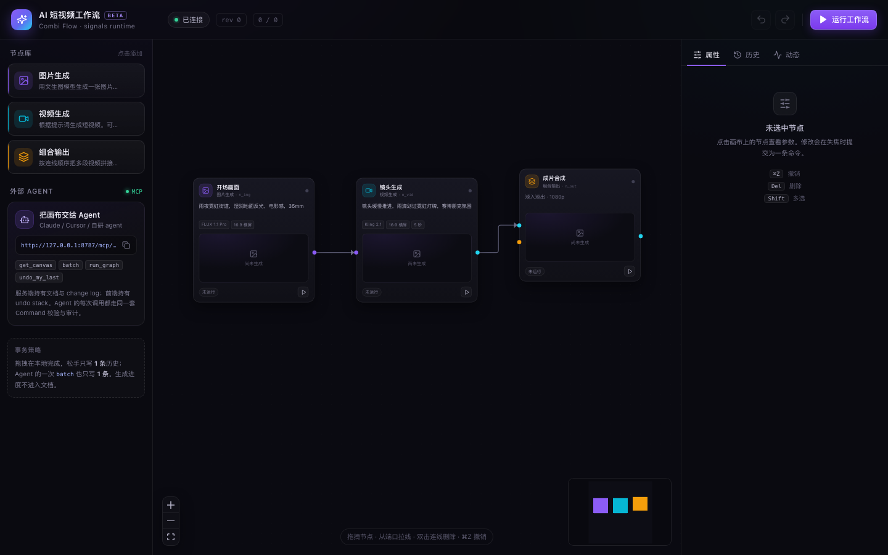

# Combi Flow

AI 短视频工作流画布：图片 → 视频 → 组合输出，支持撤销 / 重做，并且允许外部 Agent 通过 MCP 操作画布。



## 这个骨架想证明什么

1. **一次意图 = 一条历史。** 拖动节点产生的几十帧坐标变化只留在浏览器本地，松手才写入一条 `node.move`；Ctrl+Z 一次回到起点。
2. **Agent 和用户共用同一条命令日志。** 服务端持有 doc + change log，前端持有 undo stack / cursor；外部 Agent 通过 MCP 调用 `batch` 搭建链路，用户按 Ctrl+Z 能整体撤销；历史面板会标明来源。
3. **生成状态不进撤销栈。** job、progress、output、stale 属于执行面，只通过 WS 推送，永不写进文档或历史。
4. **细粒度更新。** 节点参数、runtime、位置、结构各自是独立的 signal；改一个字段不会重建整张图。

## 技术栈

- Web：React 18、Vite 7、`@preact/signals-core` / `@preact/signals-react`、React Flow 12、Immer
- Server：Node 20+、Fastify 5、`@modelcontextprotocol/sdk`、zod
- 共享内核：`packages/canvas-core`（纯 TypeScript，可单测）

## 快速开始

```bash
pnpm install
pnpm dev
```

- Web：http://127.0.0.1:5173
- API：http://127.0.0.1:8787
- MCP：http://127.0.0.1:8787/mcp/main

默认不校验 token。需要开启时：

```bash
cp .env.example .env
# CANVAS_TOKEN=dev-token
# VITE_CANVAS_TOKEN=dev-token
```

## 常用脚本

```bash
pnpm test                 # canvas-core 单测（20 个）
pnpm -r typecheck         # core / server / web
pnpm --filter @combi/web build
pnpm agent:demo           # 需要先启动 server；模拟外部 Agent 通过 MCP 操作画布
```

## 目录

```
apps/web                 Graph Runtime（signals）+ React Flow adapter + 属性 / 历史 / 动态
apps/server              Command 编排、WS、JSON 持久化、模拟执行、MCP
packages/canvas-core     文档模型、Node Registry、校验、apply、CommandLog
docs/ARCHITECTURE.md     设计基线
docs/STATUS.md           当前状态、技术债、下一步、里程碑
```

## 状态更新模型

- **服务端**：`CommandLog` 持有 `doc` + 追加式 `history`；每次命令生成 forward/inverse patch 和 `seq`。
- **前端**：`GraphState` 用 per-record signal 保存节点、runtime、视图几何；`history` 是服务端 change log 的镜像，`cursor` 由 applied 数量推导。
- **撤销**：前端发 `{ type: 'history.undo', payload: { entryId } }`；服务端校验栈顶并应用 inverse，广播 patch + history。
- **React Flow**：只消费 `nodeOrder / edgeOrder / views / edgeViews`；不把 params/runtime 塞进 `node.data`。
- **订阅**：每个组件手动调用一次 `useSignals()`，只读自己需要的 signal；没有 Babel transform。

## 手动试一下

1. 拖动任意节点 → 历史面板只多 1 条。
2. 双击连线 → 删除；Ctrl+Z 恢复。
3. 在右侧属性面板改提示词，失焦提交 → 1 条历史。
4. 点「运行工作流」→ 节点显示 progress，完成后出现 mock 产出；历史条数不变。
5. 运行 `pnpm agent:demo` → 画布出现 Agent 创建的节点，历史里标注 `Agent`；Ctrl+Z 可整体撤销。
6. 改一个已生成节点的参数 → 节点出现「参数已变更」（stale），历史只记录参数修改。

## MCP 接入

Claude Desktop / Cursor 等客户端可以连接：

```json
{
  "mcpServers": {
    "combi-canvas": {
      "url": "http://127.0.0.1:8787/mcp/main"
    }
  }
}
```

如果设置了 `CANVAS_TOKEN`：

```json
{
  "mcpServers": {
    "combi-canvas": {
      "url": "http://127.0.0.1:8787/mcp/main",
      "headers": { "Authorization": "Bearer dev-token" }
    }
  }
}
```

可用工具：

`get_canvas` · `get_node` · `list_node_types` · `add_node` · `update_node` · `move_nodes` · `connect` · `disconnect` · `delete_nodes` · `batch` · `run_node` · `run_graph` · `get_job` · `cancel_job` · `undo_my_last`

推荐循环：`list_node_types` → `get_canvas` → `batch` → `run_node` / `run_graph` → `get_job` → `get_canvas`。

## HTTP 命令

所有写操作也可以走 HTTP（会广播给所有 WS 客户端）：

```bash
curl -X POST http://127.0.0.1:8787/api/docs/main/commands \
  -H 'content-type: application/json' \
  -d '{"command":{"type":"node.move","payload":{"moves":[{"id":"n_img","position":{"x":120,"y":300}}]}}}'
```

## 已知限制

- 执行器是模拟的（本地 SVG 产出），还没有接真实视频模型。
- 没有预算 / 额度、命令幂等、字段级并发控制。
- 历史只支持 LIFO；JSON 单文件持久化；runtime 重启即清空。
- `history.status` 可变（applied/undone/discarded），严格审计需要独立 immutable log。
- 单人 + 单 Agent 场景，尚未做多人协作。

完整清单和里程碑见 [docs/STATUS.md](./docs/STATUS.md)；设计取舍见 [docs/ARCHITECTURE.md](./docs/ARCHITECTURE.md)。
