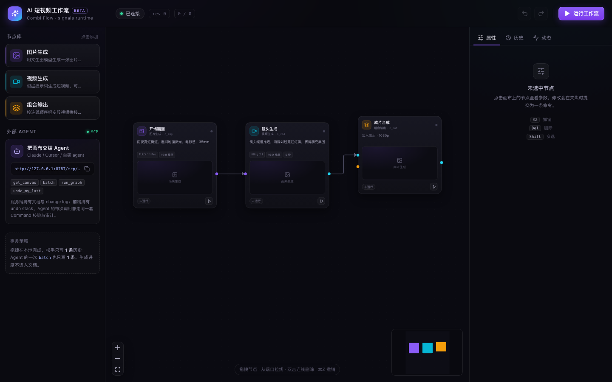

# 项目状态 · 2026-11-15

> 版本：v0.2.0（signals 重构）
> 设计基线：[`docs/ARCHITECTURE.md`](./ARCHITECTURE.md)
> 分支：`main`

---

## 1. 一句话

服务端持有 **doc + change log**，前端持有 **undo stack / cursor**；客户端用 **per-record signals** 做细粒度更新，React Flow 只做 renderer adapter。



---

## 2. 本次重构做了什么

### 删除

- `apps/web/src/store.ts`（Zustand 单一 store）
- `packages/canvas-core/src/engine.ts` 与旧 `engine.test.ts`
- `CanvasEngine` 的全局 cursor 语义
- `historyLimit` 配置
- 旧文档数据（不兼容，直接重置）

### 新增

- `@preact/signals-core` + `@preact/signals-react`（手动 `useSignals`，无 Babel transform）
- `apps/web/src/graph/state.ts`：GraphState / per-record signals / views / runtime signals
- `apps/web/src/graph/hooks.ts`：按组件的订阅模型
- `packages/canvas-core/src/apply.ts`：纯文档变更，不碰历史
- `packages/canvas-core/src/log.ts`：`CommandLog`，服务端 doc + change log
- `HistoryEntry.status`：`applied` / `undone` / `discarded`
- 客户端 undo stack：`appliedCount` / `canUndo` / `canRedo`
- `history.undo/redo` 按 `entryId` 校验
- `get_canvas` 的 history 状态、Agent `undo_my_last`

---

## 3. 已落地

### 3.1 `packages/canvas-core`

- [x] 文档模型 / Node Registry / zod 参数校验
- [x] 端口类型、单/多输入、自环/成环、级联删除
- [x] `applyDocumentCommand`：纯 patch 应用，无历史副作用
- [x] `CommandLog`：doc + entries + seq
- [x] undo / redo 按 entryId，LIFO 校验
- [x] redo 分支截断：undone → discarded
- [x] 历史状态与快照序列化
- [x] 20 个单元测试

### 3.2 `apps/server`

- [x] Fastify 5 + WS + CORS
- [x] `CommandLog` 权威文档 / 追加式日志
- [x] JSON 持久化（doc + log + statuses）
- [x] WS：snapshot / applied / runtime / command.error / resync
- [x] HTTP：docs / commands / runtime / info / health
- [x] 模拟执行引擎、progress、取消、stale
- [x] MCP 15 个工具
- [x] Agent 端到端 demo
- [x] 可选 Bearer token

### 3.3 `apps/web`

- [x] React 18 + React Flow 12 + signals
- [x] `GraphState`：nodeSignals / runtimeSignals / views / edgeViews
- [x] 手动 `useSignals()`，每个组件只读自己需要的 signal
- [x] Canvas 不读 node/runtime signal，只读几何/拓扑/拖拽
- [x] FlowNode 按 id 订阅 node/runtime
- [x] 拖拽只写 `dragPositions`，松手一条命令
- [x] 客户端 undo stack / cursor（按 entryId 发命令）
- [x] 历史面板：applied / undone / discarded 状态
- [x] Agent 操作与用户共用一条栈，source 标签
- [x] 自动重连 + snapshot 恢复
- [x] 深色 UI / toast / 动态面板

---

## 4. 如何运行

```bash
pnpm install
pnpm dev
```

- Web：http://127.0.0.1:5173
- Server：http://127.0.0.1:8787
- MCP：http://127.0.0.1:8787/mcp/main
- 健康检查：`GET /api/health`

开启 token：

```bash
cp .env.example .env
# CANVAS_TOKEN=dev-token
# VITE_CANVAS_TOKEN=dev-token
```

Agent 验收：

```bash
pnpm agent:demo
```

测试 / 类型 / 构建：

```bash
pnpm test
pnpm -r typecheck
pnpm --filter @combi/web build
```

---

## 5. 验证记录

| 项 | 结果 |
|---|---|
| `pnpm test` | ✅ 20 passed（CommandLog） |
| `pnpm -r typecheck` | ✅ core / server / web |
| `pnpm --filter @combi/web build` | ✅ 1645 modules，JS 443.82KB（gzip 140.65KB） |
| CDP 拖拽 | ✅ 15 次 mousemove → 1 条「移动「开场画面」」；⌘Z 恢复；⇧⌘Z 重做 |
| 服务端 undo/redo | ✅ 按 entryId；history status 从 applied → undone → applied |
| redo 截断 | ✅ undo 后新命令，旧 entry 标记 discarded，redo 返回 `ENTRY_NOT_REDOABLE` |
| MCP demo | ✅ batch 建链路、run_node succeeded、Agent 节点出现在画布 |
| 截图 | ✅ 1440×900 |

CDP 拖拽结果：

```text
after drag pos={x:625,y:596} rev=1 history=[移动「开场画面」:applied]
after undo pos={x:80,y:260}  rev=2 history=[移动「开场画面」:undone]
after redo pos={x:625,y:596} rev=3 history=[移动「开场画面」:applied]
```

---

## 6. 当前示例数据

- seed：`n_img`（开场画面）→ `n_vid`（镜头生成）→ `n_out`（成片合成）。
- 文档 + 日志落盘：`apps/server/data/doc-main.json`。
- runtime 不持久化：重启后 job/output 清空，doc/log 保留。
- 旧 v0.1 数据不兼容；已重置。

重置：

```bash
rm -f apps/server/data/doc-main.json
# 重启 server
```

注意：server 优雅退出会 flush；重置前先 `kill -9` 或停止后再删。

---

## 7. 已知限制与技术债

### P0 — 上线前必须

1. **预算 / 额度**：Agent 可以无限触发付费生成。
2. **命令幂等**：`clientRequestId` 只写入 id，没有服务端去重表。
3. **并发控制**：没有节点/字段级 `baseVersion`；用户与 Agent 同时改同一字段是 LIFO/覆盖。
4. **真实执行器**：仍是模拟 provider、无队列/重试/限流。
5. **持久化**：JSON 单文件，多实例/备份/迁移需要 Postgres。

### P1 — 正确性 / 体验

6. **LIFO undo**：不能从历史面板跳到任意点撤销；跨客户端 cursor 冲突只能 409。
7. **undo/redo 状态是可变字段**：`status` 在服务端可变，不是严格 append-only；审计需要单独的 immutable log。
8. **runtime 不持久化**：刷新/重启后进度和输出丢失（文档历史保留）。
9. **多客户端**：共享 log，但每个客户端 cursor 独立；同时撤销可能 409，缺 resync 提示。
10. **MCP 无状态**：进度靠 `get_job` 轮询，没有 server-initiated notifications。
11. **历史无上限**：长会话 log 会持续增长；快照/压缩未实现。
12. **边不能选中/编辑**：只能双击删除。
13. **无 server/web 自动化测试**：CDP 拖拽是一次性验证，未入库。

### P2 — 架构演进

14. **离线 / 多人实时编辑**：当前在线、服务端权威；离线需要命令队列或 CRDT。
15. **provider 插件化**：执行逻辑仍在 `execution.ts`。
16. **资产生命周期**：mock 是 data URI；真实资产需要对象存储/配额/清理。
17. **信号调试**：signals 没有 Redux/Zustand 级 devtools；靠命名 + effect 日志。

---

## 8. 下一步（按顺序）

### Step 1：并发与幂等（M1）

- `command_log` 去重：`(docId, commandId) → result`，TTL。
- 节点级 `version` + `baseRev`；冲突返回 409 + 当前节点。
- 客户端 409 时自动 resync。
- 验收：同一 clientRequestId 调用两次只生效一次；并发写同一节点后写者失败。

### Step 2：真实执行器 + 预算（M1）

- `NodeExecutor` 接口 + 1 个图片 + 1 个视频 provider。
- `run_log` 独立审计（不进 undo）。
- 预算：per-doc / per-agent；超限拒绝。
- 验收：真实生成；花费可查；删除节点取消任务。

### Step 3：Postgres 持久化（M2）

- `documents` / `command_log` / `run_log` / `assets`。
- 快照 + 分页；多实例广播。
- 验收：重启不丢；两个实例看到同一文档。

### Step 4：历史体验（M2）

- 历史面板支持「撤销到此处」（仍是 LIFO 批量）。
- 字段级冲突检测 + 冲突提示。
- 输入框外部变更提示，而不是静默 remount。
- 验收：用户与 Agent 交替编辑后，撤销不静默覆盖。

### Step 5：Agent 生产化（M3）

- OAuth / 每用户 token / doc 权限（read / write / run）。
- MCP 进度通知。
- 只读 / 受限 / 审批三种模式。
- 验收：只读 Agent 无法写；受限 Agent 无法超预算；所有操作可审计。

### Step 6：协作（M4，按需）

- presence / 光标 / 在线状态。
- 只有「多人同时编辑同一字段」成为真实需求时再上 CRDT。
- 验收：多人编辑不同节点无冲突；同节点有明确策略。

---

## 9. 里程碑

| 里程碑 | 状态 | 范围 | 验收 |
|---|---|---|---|
| **M0 骨架** | ✅ 2026-11-14 | three planes、Command、patch 历史、MCP、UI | 拖拽 1 条历史；Agent batch 可撤销 |
| **M1 signals / log 重构** | ✅ 2026-11-15 | signals runtime、CommandLog、客户端 undo stack | 20 tests；CDP 拖拽/undo/redo；MCP demo |
| **M2 可用的单人工作流** | 🔜 下一步 | 真实 provider、预算、幂等、409、run_log | 真实生成；花费可控；重试不重复 |
| **M3 生产基础设施** | ⬜ 计划 | Postgres、Redis、对象存储、快照 | 可水平扩展、可恢复 |
| **M4 Agent 生产化** | ⬜ 计划 | OAuth、权限、审批、进度通知 | 三种权限模式可配置 |
| **M5 协作** | ⬜ 按需 | presence、多人编辑、按需 CRDT | 不互相覆盖 |

---

## 10. 需要产品确认

1. 计费主体：用户 / 文档 / workspace？Agent 花费算谁的？
2. Agent 权限：能否删除 / 运行 / 超预算？
3. v1 是否需要多标签/多设备同时操作？
4. 资产留存：失败中间产物、删除节点的资产是否进回收站？
5. 视频节点真实语义：首帧图 + prompt，还是图生视频/多图参考？

---

## 11. 目录结构

```
combi-wf/
├── apps/
│   ├── server/
│   │   ├── src/
│   │   │   ├── index.ts        # Fastify + WS + MCP 路由
│   │   │   ├── service.ts      # CommandLog 编排 / 广播
│   │   │   ├── execution.ts    # 模拟执行 + stale
│   │   │   ├── store.ts        # JSON 持久化
│   │   │   ├── mcp.ts          # MCP tools
│   │   │   └── seed.ts
│   │   └── scripts/agent-demo.ts
│   └── web/
│       └── src/
│           ├── graph/
│           │   ├── state.ts    # GraphState + per-record signals
│           │   └── hooks.ts    # useSignals 封装
│           ├── components/     # Canvas / FlowNode / Inspector / History...
│           ├── commands.ts     # UI 侧命令封装
│           ├── ws.ts
│           └── styles.css
├── packages/
│   └── canvas-core/
│       └── src/
│           ├── apply.ts        # 纯文档变更
│           ├── log.ts          # CommandLog
│           ├── commands.ts
│           ├── history.ts
│           └── log.test.ts
├── docs/
│   ├── ARCHITECTURE.md
│   ├── STATUS.md
│   └── assets/canvas.png
└── ...
```

---

## 12. 风险

| 风险 | 影响 | 缓解 |
|---|---|---|
| 付费生成失控 | 亏钱 | 预算 + 审批 + 缓存 |
| Agent/用户并发覆盖 | 数据丢失 | 节点版本 + 409 |
| 单文件 JSON 损坏 | 文档丢失 | 尽快迁移 Postgres |
| 历史 status 可变 | 审计不可靠 | 独立 immutable run/command log |
| 客户端 cursor 分叉 | 撤销失败 | 409 + resync + UI 提示 |
| signals 漏 `useSignals` | UI 不更新 | 约定 hook、code review、必要时上 transform |
| 节点 schema 演进 | 旧参数不合法 | zod 默认值 + 迁移脚本 |
